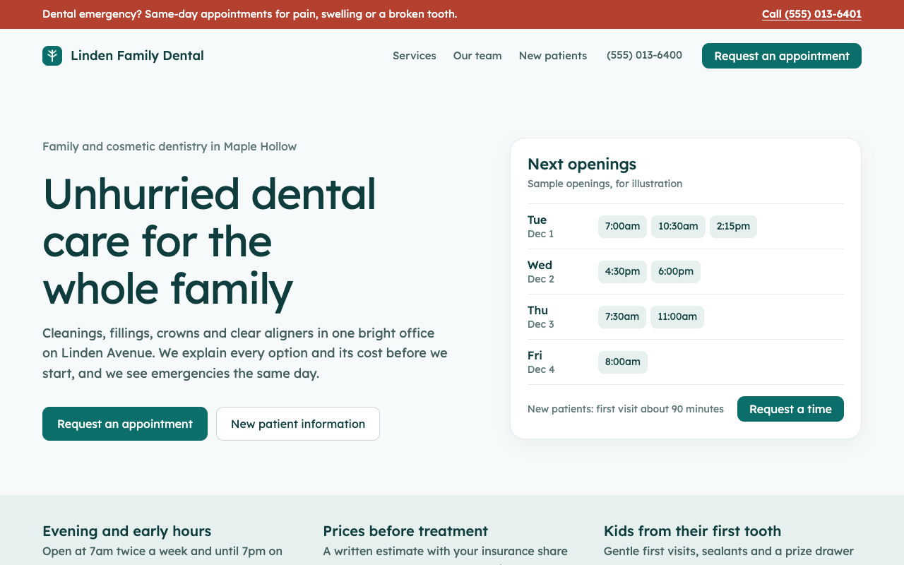

# Linden Family Dental: dental practice website template

A calm, clear website for a dental practice: services, the team, new patient information with insurance and payment options, an emergency banner and an appointment request form. Built with Astro as a fully static site.



[](https://console.cloudzyro.com/new?repo=https://github.com/Cloudzyro/template-dental)

## What's included

- Emergency banner on every page with a click-to-call emergency number
- Home page with a "next openings" card (sample times you edit, or link to live scheduling), reasons to choose the practice, services, a membership plan for people without insurance and the team
- Services page with what to expect at each kind of visit
- Team page grouped into dentists, hygienists and front desk
- New patients page: first visit steps, what to bring, forms to download, insurance accepted (a sample list), payment options and the in-house plan
- Appointment request form (new or existing patient, reason, days and times, insurance) that works without a server, with a note asking people not to send medical details
- Dentist structured data, Open Graph tags, sitemap, robots.txt and favicon
- Responsive down to 360px, keyboard friendly, visible focus styles and reduced motion respected
- No tracking and no third-party scripts

## Run it locally

You need Node 22.23 or newer and pnpm.

```bash
pnpm install
pnpm dev       # http://localhost:4321
pnpm build     # static site in dist/
pnpm preview   # serve the build
```

## Make it yours

- **Content:** everything lives in `src/data/site.ts`: practice details, phone and emergency numbers, hours, the emergency banner text, home page openings, services, team, new patient steps, forms, insurance list, payment options, the membership plan and the appointment form's options.
- **Insurance:** the insurance list in the demo is a sample. Replace it with the plans your office really accepts.
- **Online scheduling:** if you use NexHealth, LocalMed, Zocdoc or similar, set `bookingUrl` and the "Request a time" button goes there.
- **Patient forms:** put your PDFs in `public/forms/` and set each form's `url` (for example `/forms/new-patient.pdf`).
- **Appointment form:** set `PUBLIC_FORM_ENDPOINT` to a form service address (Formspree, Basin, a Supabase function or similar). With no endpoint set, the form shows a short note and opens the visitor's email app addressed to your `email`. Use a HIPAA-eligible form service if you collect anything beyond contact details and preferred times.
- **Site address:** set `SITE_URL` (for example `https://www.yourpractice.com`) so the sitemap, canonical links and social previews use it.
- **Colors and fonts:** the variables at the top of `src/styles/global.css`. The font is Lexend, self-hosted through Fontsource.
- **Social preview image:** replace `public/og.png` (1200 x 630).

Copy `.env.example` to `.env` to set the variables locally. On Cloudzyro, add them in your site's environment settings.

## Deploy

Click the button above to make your own copy and put it online, or push your copy to GitHub and connect the repository in the Cloudzyro console. It builds with `pnpm build` and serves the static `dist/` folder.

## Stack

- [Astro](https://astro.build) 7, static output
- `@astrojs/sitemap`
- Lexend via Fontsource
- Plain CSS and a few lines of TypeScript for the form

## License

MIT, see [LICENSE](./LICENSE).
